# Reporte de pruebas: cinco modelos ligeros en la Raspberry Pi 5

Comparación de los cinco clasificadores ligeros de residuos del proyecto (5 clases: `aluminio`, `carton`, `otros`, `plastico`, `vidrio`) en la **Raspberry Pi 5**, el dispositivo de despliegue:

- MobileNetV3-Large
- EfficientNetB0
- ShuffleNetV2 (pesos de ImageNet)
- SqueezeNet v1.1 (pesos de ImageNet), nuevo
- YOLO11s-cls, nuevo

Se evaluaron los archivos `.tflite`, es decir, los mismos que se instalarían en el sistema final. **Todas las cifras, gráficas y capturas de este reporte se midieron en la Raspberry Pi 5**; no incluye resultados de la laptop de desarrollo.

**Versión del reporte:** recomienda **MobileNetV3-Large** para el despliegue. Existen otras dos versiones con el mismo contenido y las mismas cifras: una que recomienda YOLO11s-cls y otra sin recomendación única.

Fecha de las pruebas: 17 de octubre de 2026.

---

## 1. Resumen

| Modelo | Accuracy | Errores | F1 macro | Latencia media | Cuadros/s | Peor caso | RAM del modelo | `.tflite` |
|---|---|---|---|---|---|---|---|---|
| MobileNetV3-Large | 96.47% | 160 / 4,534 | 0.9627 | 15.54 ms | 64.3 | 18.29 ms | 17.1 MB | 3.24 MB |
| EfficientNetB0 | 96.67% | 151 / 4,534 | 0.9648 | 45.46 ms | 22.0 | 49.40 ms | 34.2 MB | 4.50 MB |
| ShuffleNetV2 (ImageNet) | 94.18% | 264 / 4,534 | 0.9381 | **9.49 ms** | **105.3** | **11.60 ms** | 12.2 MB | 1.50 MB |
| SqueezeNet v1.1 (ImageNet) | 91.75% | 374 / 4,534 | 0.9111 | 9.95 ms | 100.5 | 13.46 ms | **10.9 MB** | **0.81 MB** |
| YOLO11s-cls | **97.44%** | **116 / 4,534** | **0.9728** | 23.78 ms | 42.0 | 26.39 ms | 21.7 MB | 5.39 MB |

- **Precisión:** YOLO11s-cls es el más preciso y su ventaja es estadísticamente significativa frente a los otros cuatro modelos: 44 errores menos que MobileNetV3-Large y 35 menos que EfficientNetB0 (McNemar exacto con corrección de Holm, p = 7.5 × 10⁻⁴ y p = 0.0097). MobileNetV3-Large y EfficientNetB0 siguen siendo equivalentes entre sí (p = 0.51). SqueezeNet v1.1 es el menos preciso: 110 errores más que ShuffleNetV2 y 214 más que MobileNetV3-Large.
- **Velocidad:** ShuffleNetV2 (9.49 ms) y SqueezeNet (9.95 ms) son los más rápidos. YOLO11s-cls tarda 23.78 ms: 1.53 veces más que MobileNetV3-Large, pero 1.91 veces menos que EfficientNetB0, aunque hace más operaciones que este.
- **Hipótesis H1 (latencia < 200 ms):** los cinco modelos la cumplen con amplio margen. El peor caso del modelo más lento (EfficientNetB0, 49.40 ms) queda 4.0 veces por debajo del límite; el de YOLO11s-cls (26.39 ms), 7.6 veces.
- **Estabilidad:** en 5 minutos de inferencia continua por modelo, la deriva de latencia no pasó de 0.17%, la RAM del proceso no creció más de 0.02 MB y no hubo throttling ni bajo voltaje (`0x0`). La CPU se mantuvo fija a 2400 MHz y la temperatura máxima fue de 60.6 °C.
- **Repetibilidad:** los tres modelos que ya se habían medido el 13/10/2026 dieron exactamente las mismas predicciones en las 4,534 imágenes y una latencia que cambió entre 0.1% y 1.5%.

**Modelo recomendado para el despliegue: MobileNetV3-Large.** Es 1.53 veces más rápido que YOLO11s-cls (15.54 frente a 23.78 ms), ocupa 21% menos RAM (17.1 frente a 21.7 MB), su archivo pesa 40% menos y recibe la imagen completa, sin recorte. Iguala en precisión a EfficientNetB0 con la tercera parte de su latencia. A cambio, comete 44 errores más que YOLO11s-cls (0.97 puntos de accuracy, diferencia significativa): es el precio de mantener el mayor margen de CPU y la integración más sencilla.

---

## 2. Entorno de pruebas

| | Raspberry Pi 5 |
|---|---|
| Placa | Raspberry Pi 5 Model B Rev 1.1, 16 GB de RAM |
| Procesador | Broadcom BCM2712, 4 × Cortex-A76 a 2.4 GHz, con ventilador activo |
| Sistema | Debian 13 (trixie), kernel 6.18.50+rpt-rpi-2712 |
| Python | 3.13.5 |
| Runtime | `ai-edge-litert` 2.2.0 (`.tflite` en CPU, delegado XNNPACK) |
| Hilos de inferencia | 1, el valor por defecto del runtime (se deduce del 25% de CPU: un núcleo de cuatro); también se probó con 4 (sección 8) |
| Gobernador de CPU | `ondemand` |

**Conjunto de prueba:** `data/raw/waste_classification/test`, con **4,534 imágenes**: aluminio 888, cartón 730, otros 1,164, plástico 1,268 y vidrio 484. Son las mismas imágenes que usan los notebooks de evaluación. Se excluyen 3 archivos con formatos que Keras no lee (`.gif`, `.HEIC` y `.webp`), igual que hace `ImageDataGenerator`.

**Modelos evaluados:** todos usan cuantización de rango dinámico (pesos int8, activaciones float32), solo operaciones nativas de TFLite y una salida `[1, 5]` con softmax.

| Modelo | Archivo `.tflite` | Tamaño | Entrada | SHA-256 (inicio) |
|---|---|---|---|---|
| MobileNetV3-Large | `modelo_residuos_rpi_V3_05.tflite` | 3.24 MB | `[1, 224, 224, 3]` | `210bcb2d2e96` |
| EfficientNetB0 | `modelo_residuos_EfficientNetB0_v1.tflite` | 4.50 MB | `[1, 224, 224, 3]` | `68bc45964ded` |
| ShuffleNetV2 (ImageNet) | `modelo_residuos_shufflenetV2_imagenet.tflite` | 1.50 MB | `[1, 224, 224, 3]` | `d51cfc1eb7bc` |
| SqueezeNet v1.1 (ImageNet) | `modelo_residuos_SqueezeNet_imagenet.tflite` | 0.81 MB | `[1, 224, 224, 3]` | `c3ede257a84b` |
| YOLO11s-cls | `modelo_residuos_YOLO_v1.tflite` | 5.39 MB | `[1, 3, 224, 224]` | `3c852d18d78b` |

El SHA-256 completo de cada archivo quedó guardado en el JSON de resultados.

**Preprocesamiento:** cada modelo recibe las imágenes con el mismo preprocesamiento con el que se entrenó.

| Modelos | Preprocesamiento | Pixeles | Ejes |
|---|---|---|---|
| MobileNetV3-Large, EfficientNetB0, ShuffleNetV2, SqueezeNet v1.1 (entrenados con Keras) | RGB, estirado a 224×224 con interpolación *nearest*, como `flow_from_directory` | `float32` de 0 a 255; la normalización va dentro de la red | NHWC |
| YOLO11s-cls (entrenado con Ultralytics) | RGB, lado corto a 224 con interpolación bilineal y recorte central de 224×224, como `classify_transforms` de Ultralytics | `float32` de 0 a 1 (dividido entre 255) | NCHW |

Respetar el preprocesamiento de entrenamiento es indispensable, sobre todo para YOLO11s-cls: su entrada difiere de la de los modelos de Keras en la escala de los pixeles, en el recorte y en el orden de los ejes.

**Notas metodológicas:**

- Las imágenes se cargan en memoria antes de medir, en dos juegos, uno por preprocesamiento. La conversión de tipo, la escala y la transposición quedan fuera del cronómetro; se mide solo `set_tensor + invoke + get_tensor`.
- El *data augmentation* de YOLO11s-cls fue distinto al de los demás: se usó el de Ultralytics (recortes aleatorios y RandAugment, sin rotación). Se entrenó en 2 fases desde `yolo11s-cls.pt` (15 épocas con `freeze=10` y 20 con `freeze=7`) y se exportó el último *checkpoint* (`last.pt`).
- Los cinco modelos usaron la carpeta `test/` como validación durante el entrenamiento, pero ninguno usa *early stopping* ni guarda el mejor modelo según esa validación. Por eso `test/` no influyó en qué pesos se eligieron y la evaluación sigue siendo válida.

---

## 3. Precisión de clasificación

Corrida oficial: `pruebas_modelos/raspberry/benchmark_visual.py` con los parámetros por defecto (todas las imágenes, 10 inferencias de calentamiento, 5 minutos de estabilidad por modelo y 60 s de enfriamiento antes de cada modelo). Duró 39 min 53 s, del 17/10/2026 17:55 a las 18:35. Datos crudos: `reports/benchmark_rpi5_5modelos/resultados_rpi5_5modelos_1hilo.json`; registro de la terminal: `reports/benchmark_rpi5_5modelos/log_rpi5_5modelos_1hilo.txt`.

| Modelo | Accuracy | IC 95% (Wilson) | Errores | Precisión macro | Recall macro | F1 macro |
|---|---|---|---|---|---|---|
| MobileNetV3-Large | 96.47% | 95.89 – 96.97% | 160 | 0.9650 | 0.9608 | 0.9627 |
| EfficientNetB0 | 96.67% | 96.11 – 97.15% | 151 | 0.9650 | 0.9646 | 0.9648 |
| ShuffleNetV2 (ImageNet) | 94.18% | 93.46 – 94.82% | 264 | 0.9402 | 0.9366 | 0.9381 |
| SqueezeNet v1.1 (ImageNet) | 91.75% | 90.91 – 92.52% | 374 | 0.9138 | 0.9097 | 0.9111 |
| YOLO11s-cls | **97.44%** | 96.94 – 97.86% | **116** | **0.9744** | **0.9713** | **0.9728** |

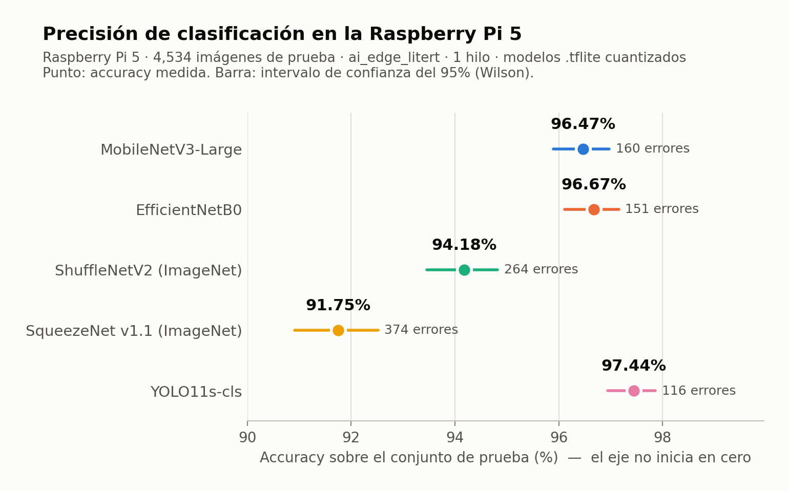

### 3.1 Significancia estadística

Prueba de McNemar exacta sobre las mismas 4,534 imágenes. Con 5 modelos hay 10 comparaciones por pares, así que los valores p se ajustan con la corrección de **Holm** para mantener el error global en 5%.

| Comparación | Solo acierta el primero | Solo acierta el segundo | p | p ajustado (Holm) | ¿Diferencia significativa? |
|---|---|---|---|---|---|
| MobileNetV3-Large vs EfficientNetB0 | 68 | 77 | 0.51 | 0.51 | No |
| MobileNetV3-Large vs ShuffleNetV2 | 161 | 57 | 1.1 × 10⁻¹² | 5.6 × 10⁻¹² | Sí |
| MobileNetV3-Large vs SqueezeNet v1.1 | 273 | 59 | 4.9 × 10⁻³⁴ | 3.9 × 10⁻³³ | Sí |
| MobileNetV3-Large vs YOLO11s-cls | 48 | 92 | 2.5 × 10⁻⁴ | 7.5 × 10⁻⁴ | Sí |
| EfficientNetB0 vs ShuffleNetV2 | 167 | 54 | 1.3 × 10⁻¹⁴ | 7.6 × 10⁻¹⁴ | Sí |
| EfficientNetB0 vs SqueezeNet v1.1 | 279 | 56 | 9.7 × 10⁻³⁷ | 8.7 × 10⁻³⁶ | Sí |
| EfficientNetB0 vs YOLO11s-cls | 56 | 91 | 0.0049 | 0.0097 | Sí |
| ShuffleNetV2 vs SqueezeNet v1.1 | 212 | 102 | 5.2 × 10⁻¹⁰ | 2.1 × 10⁻⁹ | Sí |
| ShuffleNetV2 vs YOLO11s-cls | 38 | 186 | 1.3 × 10⁻²⁴ | 9.1 × 10⁻²⁴ | Sí |
| SqueezeNet v1.1 vs YOLO11s-cls | 38 | 296 | 1.1 × 10⁻⁵⁰ | 1.1 × 10⁻⁴⁹ | Sí |

El orden por precisión queda así: **YOLO11s-cls > {EfficientNetB0 ≈ MobileNetV3-Large} > ShuffleNetV2 > SqueezeNet v1.1**. La única pareja sin diferencia significativa es MobileNetV3-Large frente a EfficientNetB0.

### 3.2 Accuracy por clase

| Clase (n) | MobileNetV3-Large | EfficientNetB0 | ShuffleNetV2 | SqueezeNet v1.1 | YOLO11s-cls |
|---|---|---|---|---|---|
| aluminio (888) | **97.86%** | 97.52% | 95.50% | 93.92% | 97.41% |
| carton (730) | 97.53% | 98.36% | 97.40% | 95.62% | **99.04%** |
| otros (1,164) | 97.68% | 97.08% | 95.27% | 92.70% | **97.85%** |
| plastico (1,268) | 95.58% | 95.98% | 93.14% | 91.01% | **97.56%** |
| vidrio (484) | 91.74% | 93.39% | 86.98% | 81.61% | **93.80%** |

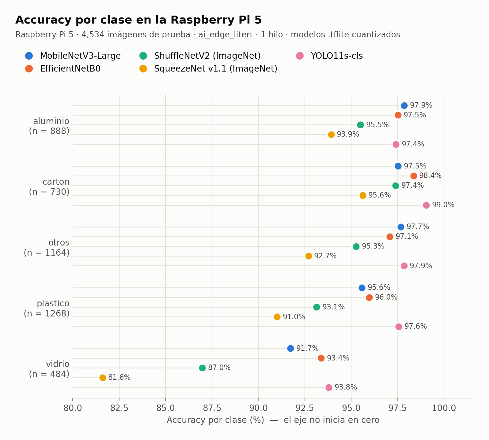

YOLO11s-cls es el mejor en cuatro de las cinco clases; en `aluminio` queda a 0.45 puntos de MobileNetV3-Large. Su ventaja más clara está en `plastico` (+1.6 puntos sobre el siguiente), la clase con más imágenes.

### 3.3 Matrices de confusión

Filas = clase real, columnas = clase predicha; orden aluminio, carton, otros, plastico, vidrio.

```
MobileNetV3-Large            EfficientNetB0               ShuffleNetV2 (ImageNet)
[ 869    1    9    7    2]   [ 866    6    7    7    2]   [ 848    6   20    7    7]
[   6  712    9    3    0]   [   4  718    6    1    1]   [   9  711    5    5    0]
[  11   10 1137    6    0]   [  12   10 1130   10    2]   [  17   11 1109   18    9]
[  19    8   16 1212   13]   [  17    8   10 1217   16]   [  33    9   26 1181   19]
[   8    1    9   22  444]   [   5    0    5   22  452]   [  11    2   15   35  421]

SqueezeNet v1.1 (ImageNet)   YOLO11s-cls
[ 834   17   19    5   13]   [ 865    4    5    8    6]
[  11  698   12    7    2]   [   0  723    4    3    0]
[  38   19 1079   24    4]   [   4    7 1139   13    1]
[  46   16   25 1154   27]   [  12    7    5 1237    7]
[  28    2   11   48  395]   [   4    0    3   23  454]
```

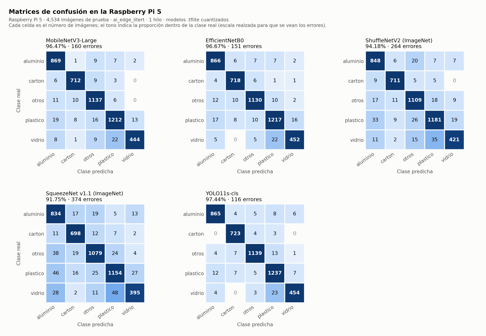

**Observaciones:**

- `vidrio` sigue siendo la clase más difícil para los cinco modelos y su error principal es siempre el mismo: confundirse con `plastico` (22, 22, 35, 48 y 23 casos). Ambos materiales son transparentes y se parecen en las fotos; además, `vidrio` tiene menos imágenes (484).
- Otro error frecuente en los cinco modelos es `plastico` → `aluminio` (12 a 46 casos según el modelo): envolturas metalizadas y empaques brillantes.
- YOLO11s-cls no confunde ninguna imagen de `carton` con `aluminio` ni con `vidrio`, y es el que menos se equivoca en `plastico` (31 errores, frente a 51 a 114 de los demás).
- SqueezeNet v1.1 pierde precisión en todas las clases; su caída es mayor en `vidrio` (81.61%) y en `otros`, que confunde con `aluminio` 38 veces.

### 3.4 Coincidencia de errores y casos difíciles

| Cuántos modelos fallan la imagen | 0 | 1 | 2 | 3 | 4 | 5 |
|---|---|---|---|---|---|---|
| Imágenes | 3,976 | 308 | 113 | 58 | 38 | 41 |

| Modelo | Errores | Solo este modelo | Entre 2 y 4 modelos | Los 5 modelos |
|---|---|---|---|---|
| MobileNetV3-Large | 160 | 25 | 94 | 41 |
| EfficientNetB0 | 151 | 25 | 85 | 41 |
| ShuffleNetV2 (ImageNet) | 264 | 67 | 156 | 41 |
| SqueezeNet v1.1 (ImageNet) | 374 | 174 | 159 | 41 |
| YOLO11s-cls | 116 | 17 | 58 | 41 |

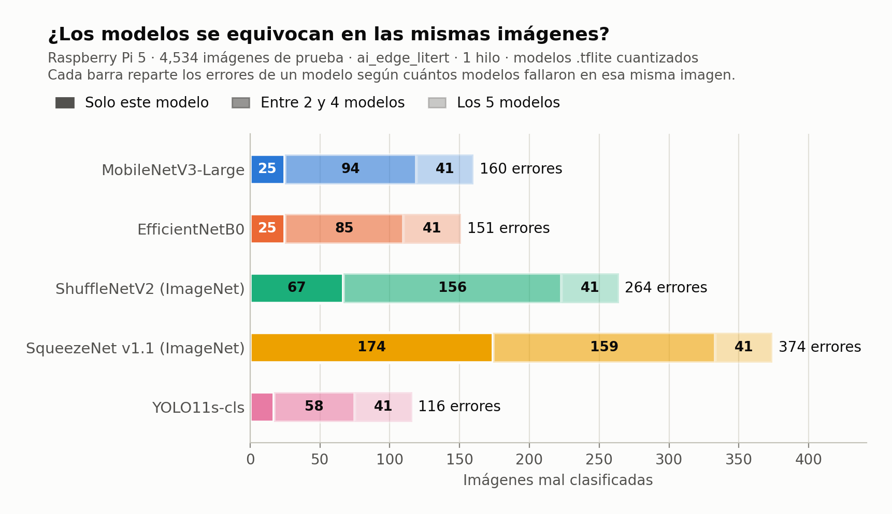

- 3,976 imágenes (87.7%) las aciertan los cinco modelos y solo 41 (0.9%) las fallan todos.
- SqueezeNet comete 174 errores que ningún otro modelo comete; YOLO11s-cls, solo 17.
- Las 41 imágenes que fallan los cinco modelos son, sobre todo, casos ambiguos: vidrio roto o pintado, botellas de plástico transparente con dosificador que parecen de vidrio, envolturas metalizadas, pilas de botón y objetos sobre fondos con textura. Algunas parecen **errores de etiqueta del propio dataset**. En la figura siguiente, `vidrio/glass_1338.jpg` (quinta imagen) parece una botella de plástico con tapa azul, y los cinco modelos la clasifican como `plastico`, tres de ellos con 100% de confianza. Fuera de la figura, `plastico/plastic_soda_bottles_315.png` muestra cuatro latas de refresco de aluminio y los cinco modelos la clasifican como `aluminio` con 100% de confianza. Esos casos castigan por igual a todos los modelos y no cambian la comparación.

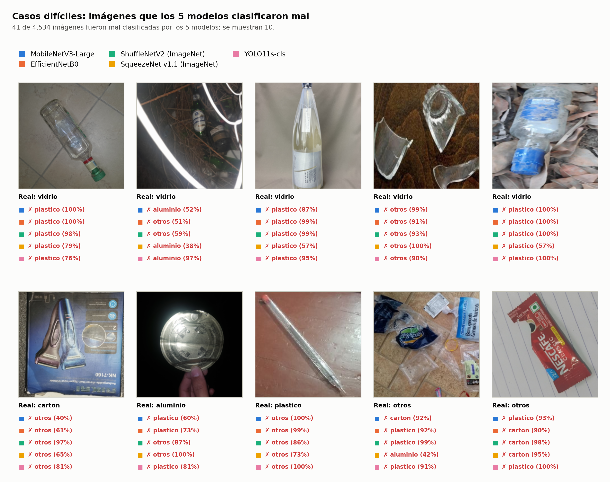

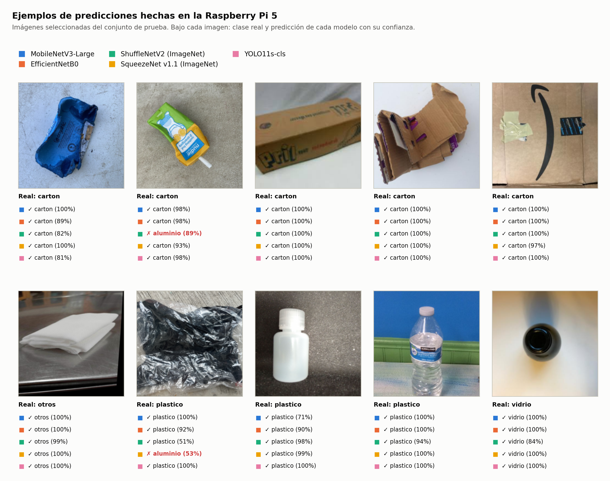

---

## 4. Latencia de inferencia

Se cronometra `set_tensor + invoke + get_tensor` de cada imagen y se descartan las primeras 10 inferencias como calentamiento, así que cada modelo tiene 4,524 mediciones.

| Modelo | Media | Desv. est. | Mín | P50 | P95 | P99 | Máx | Cuadros/s | Margen frente a H1 (peor caso) |
|---|---|---|---|---|---|---|---|---|---|
| MobileNetV3-Large | 15.54 ms | 0.12 | 15.46 | 15.53 | 15.61 | 15.69 | 18.29 | 64.3 | ×10.9 |
| EfficientNetB0 | 45.46 ms | 0.18 | 45.29 | 45.44 | 45.57 | 45.76 | 49.40 | 22.0 | ×4.0 |
| ShuffleNetV2 (ImageNet) | 9.49 ms | 0.07 | 9.41 | 9.49 | 9.55 | 9.64 | 11.60 | 105.3 | ×17.2 |
| SqueezeNet v1.1 (ImageNet) | 9.95 ms | 0.18 | 9.82 | 9.90 | 10.24 | 10.42 | 13.46 | 100.5 | ×14.9 |
| YOLO11s-cls | 23.78 ms | 0.12 | 23.68 | 23.77 | 23.86 | 24.00 | 26.39 | 42.0 | ×7.6 |

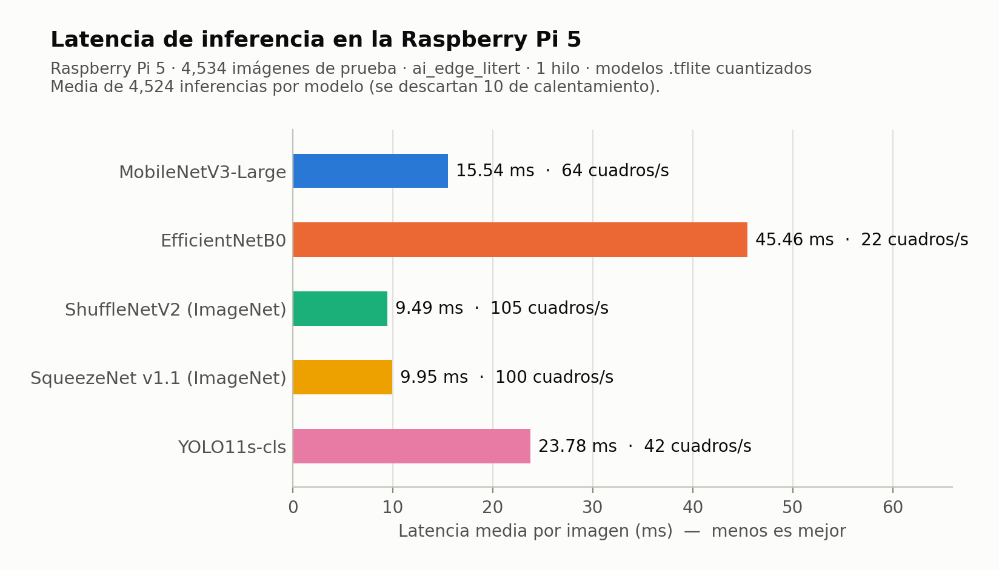

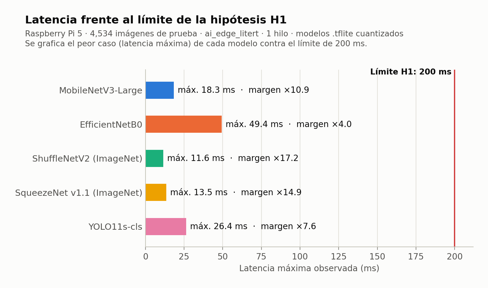

La latencia es muy estable en los cinco modelos: la desviación estándar no pasa de 0.18 ms y el P99 queda a menos de 0.5 ms de la media. Los picos aislados (el máximo de cada modelo) quedan de 2 a 4 ms por encima de la media; como el benchmark usa un solo hilo, lo más probable es que se deban a otros procesos del sistema que compiten por la CPU.

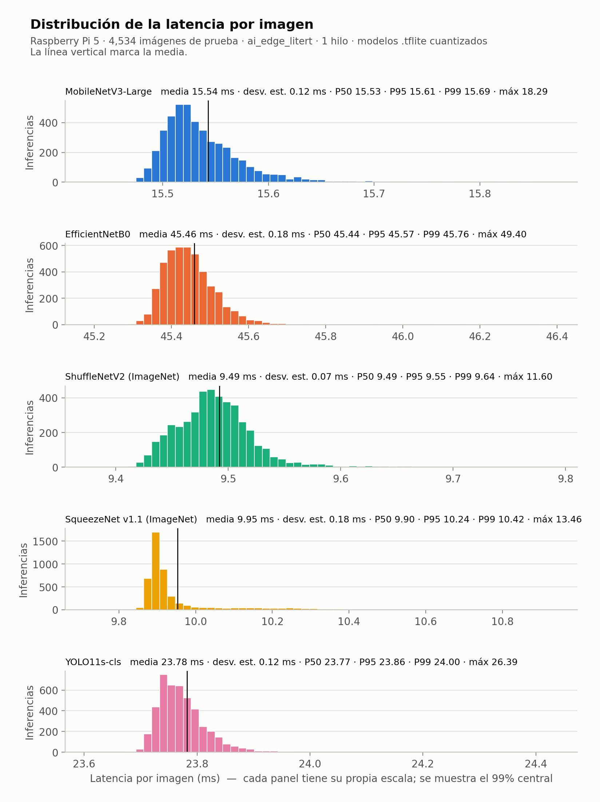

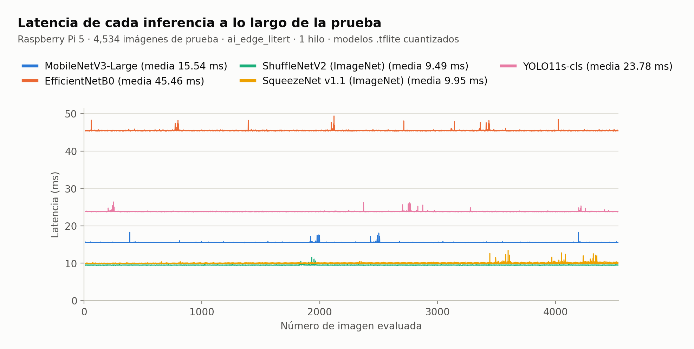

**YOLO11s-cls es más rápido de lo que su tamaño sugiere.** Hace unas 4 veces más operaciones que EfficientNetB0 (~1.5 GFLOPs frente a ~0.39 a 224 px) y, aun así, en la Raspberry tarda la mitad (23.8 frente a 45.5 ms). Lo más probable es que se deba al tipo de capas: YOLO11s-cls usa sobre todo convoluciones densas de 3×3, que el delegado XNNPACK aprovecha bien en los Cortex-A76, mientras que EfficientNetB0 encadena convoluciones *depthwise* de 5×5, bloques *squeeze-and-excitation* y activaciones *swish*, que hacen pocas operaciones por cada byte que leen de memoria.

**Costo del preprocesamiento:** decodificar y preparar las 4,534 imágenes del set de prueba (JPEG/PNG de tamaños variados, por ejemplo 1920×1024) tomó:

| Juego | Modelos | Tiempo total | Por imagen |
|---|---|---|---|
| Estirado *nearest* | MobileNetV3-Large, EfficientNetB0, ShuffleNetV2, SqueezeNet v1.1 | 41.9 s | 9.2 ms |
| Recorte central bilineal | YOLO11s-cls | 56.9 s | 12.5 ms |

Esto queda fuera de la latencia medida, pero en el sistema final se suma a la inferencia. Aun en el peor caso observado y sumando el preprocesamiento, todos los modelos cumplen H1 con holgura: EfficientNetB0 llegaría a 58.6 ms (margen ×3.4), YOLO11s-cls a 38.9 ms (×5.1) y MobileNetV3-Large a 27.5 ms (×7.3). Con la cámara el costo debería ser menor, porque los cuadros ya llegan con resolución reducida y no hay que decodificar archivos grandes.

**Repetibilidad:** MobileNetV3-Large, EfficientNetB0 y ShuffleNetV2 ya se habían medido en esta misma Raspberry el 13/10/2026. Cuatro días después dieron **exactamente las mismas predicciones** en las 4,534 imágenes y una latencia media muy parecida: 15.50 → 15.54 ms (+0.3%), 45.40 → 45.46 ms (+0.1%) y 9.35 → 9.49 ms (+1.5%).

---

## 5. Estabilidad (5 minutos de inferencia continua por modelo)

| Modelo | Inferencias | Inf/s | CPU media (máx) | Deriva de latencia | Δ RAM | Temp. media / máx | Frecuencia | Throttling |
|---|---|---|---|---|---|---|---|---|
| MobileNetV3-Large | 19,104 | 63.7 | 25.1% (28.2%) | −0.04% | 0.00 MB | 58.1 / 60.6 °C | 2400 MHz fija | ninguno (`0x0`) |
| EfficientNetB0 | 6,557 | 21.9 | 25.1% (27.8%) | +0.01% | 0.01 MB | 57.2 / 59.0 °C | 2400 MHz fija | ninguno (`0x0`) |
| ShuffleNetV2 (ImageNet) | 31,079 | 103.6 | 25.1% (27.7%) | +0.05% | 0.00 MB | 58.1 / 60.0 °C | 2400 MHz fija | ninguno (`0x0`) |
| SqueezeNet v1.1 (ImageNet) | 29,815 | 99.4 | 25.1% (27.4%) | −0.04% | 0.00 MB | 58.0 / 60.0 °C | 2400 MHz fija | ninguno (`0x0`) |
| YOLO11s-cls | 12,399 | 41.3 | 25.1% (26.5%) | +0.17% | 0.02 MB | 57.5 / 60.6 °C | 2400 MHz fija | ninguno (`0x0`) |

La deriva compara la latencia media del primer 10% de la prueba con la del último 10%.

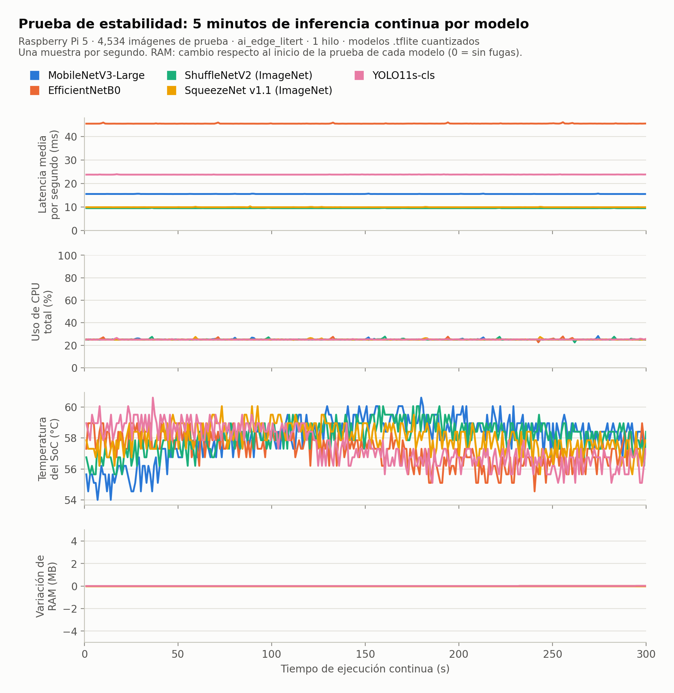

- **CPU al 25%:** con un hilo, el intérprete ocupa uno de los 4 núcleos al 100% y deja libres los otros tres para la cámara, la interfaz y el control de actuadores. Ningún modelo pasó de 28.2% de CPU total.
- **Temperatura:** los cinco modelos se mantuvieron entre 54 y 61 °C. Las diferencias entre ellos dependen sobre todo del ventilador activo, que se enciende y se apaga por umbrales, y no del modelo: todos ocupan el mismo núcleo al 100%. Ninguno se acercó a los 80 °C en que el SoC empieza a reducir la frecuencia.
- **RAM:** la memoria del proceso cambió como máximo 0.02 MB en 5 minutos, así que no hay fugas.

---

## 6. Consumo de recursos

| Modelo | `.tflite` | RAM del modelo cargado* | Tiempo de carga | CPU en inferencia continua |
|---|---|---|---|---|
| MobileNetV3-Large | 3.24 MB | 17.1 MB | 14.9 ms | 25.1% |
| EfficientNetB0 | 4.50 MB | 34.2 MB | 20.0 ms | 25.1% |
| ShuffleNetV2 (ImageNet) | 1.50 MB | 12.2 MB | 8.6 ms | 25.1% |
| SqueezeNet v1.1 (ImageNet) | 0.81 MB | 10.9 MB | 5.8 ms | 25.1% |
| YOLO11s-cls | 5.39 MB | 21.7 MB | 22.8 ms | 25.1% |

\* Medida en un proceso aislado: la RAM del proceso con el modelo cargado y 30 inferencias ejecutadas, menos la del proceso vacío (46.7 MB, Python + numpy + runtime).

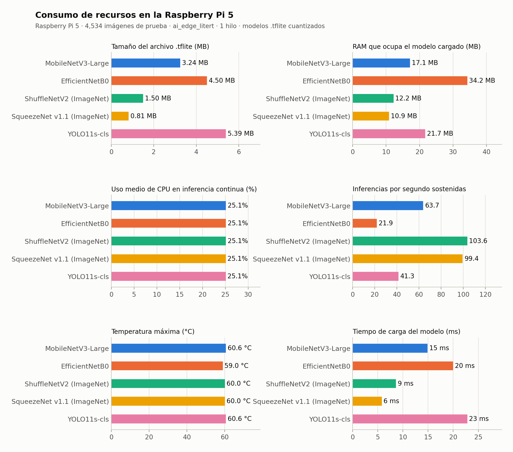

Los cinco modelos son ligeros para una Raspberry Pi 5 de 16 GB: el más pesado (EfficientNetB0) ocupa 34 MB de RAM y todos cargan en menos de 25 ms. YOLO11s-cls tiene el archivo más grande (5.39 MB), pero ocupa 37% menos RAM que EfficientNetB0.

---

## 7. Compromiso entre precisión y velocidad

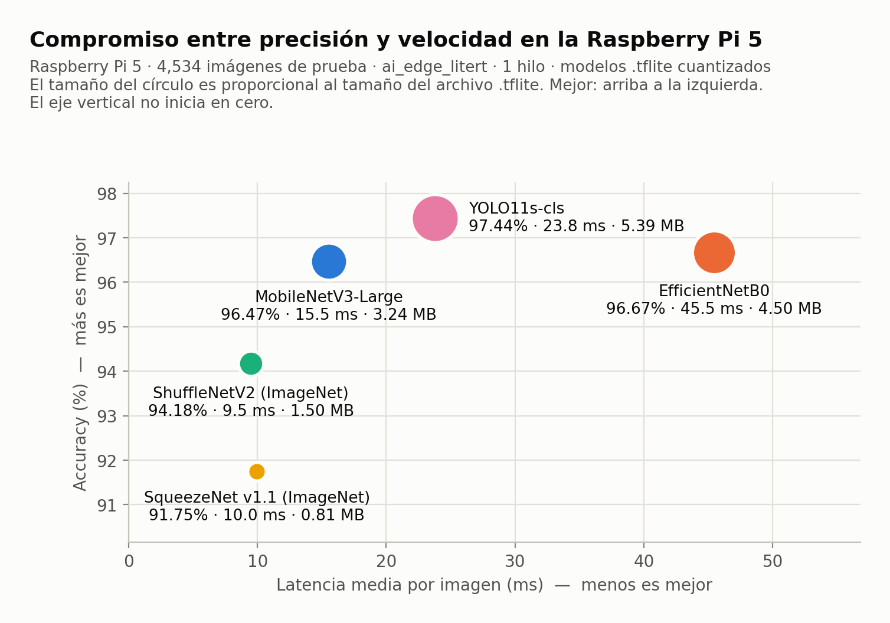

- **Frontera de Pareto:** ShuffleNetV2 (el más rápido), MobileNetV3-Large y YOLO11s-cls (el más preciso). Para cada uno de ellos no hay otro modelo que sea a la vez más rápido y más preciso.
- **EfficientNetB0 queda dominado por YOLO11s-cls:** YOLO es más preciso (35 errores menos, diferencia significativa) y 1.9 veces más rápido.
- **SqueezeNet v1.1 queda dominado por ShuffleNetV2:** ShuffleNetV2 es igual de rápido (9.5 frente a 10.0 ms) y comete 110 errores menos. La única ventaja de SqueezeNet es el tamaño: 0.81 MB de archivo y 10.9 MB de RAM.
- Entre los tres modelos de la frontera, cada paso hacia más precisión cuesta latencia: de ShuffleNetV2 a MobileNetV3-Large, +6 ms por 104 errores menos; de MobileNetV3-Large a YOLO11s-cls, +8 ms por 44 errores menos.

---

## 8. Prueba complementaria: 4 hilos de inferencia

Por defecto el intérprete usa un solo hilo, así que ocupa uno de los cuatro núcleos. Para saber cuánto se gana repartiendo la inferencia entre los cuatro, se repitió la prueba con `--num-threads 4`: mismas 4,534 imágenes y 2 minutos de estabilidad por modelo. La corrida fue el 17/10/2026 de 18:35 a 18:56. Datos crudos: `reports/benchmark_rpi5_5modelos/resultados_rpi5_5modelos_4hilos.json`.

| Modelo | Latencia 1 hilo | Latencia 4 hilos | Aceleración | Desv. est. (1 → 4 hilos) | Máx 4 hilos | CPU 4 hilos | Temp. máx 4 hilos |
|---|---|---|---|---|---|---|---|
| MobileNetV3-Large | 15.54 ms | 10.16 ms | ×1.53 | 0.12 → 1.59 ms | 26.59 ms | 96.0% | 67.8 °C |
| EfficientNetB0 | 45.46 ms | 29.23 ms | ×1.56 | 0.18 → 1.52 ms | 68.19 ms | 96.2% | 69.4 °C |
| ShuffleNetV2 (ImageNet) | 9.49 ms | 7.06 ms | ×1.34 | 0.07 → 0.73 ms | 24.47 ms | 97.0% | 67.2 °C |
| SqueezeNet v1.1 (ImageNet) | 9.95 ms | 4.64 ms | ×2.15 | 0.18 → 0.18 ms | 9.87 ms | 91.3% | 68.8 °C |
| YOLO11s-cls | 23.78 ms | 12.96 ms | ×1.83 | 0.12 → 0.40 ms | 21.39 ms | 92.7% | 69.4 °C |

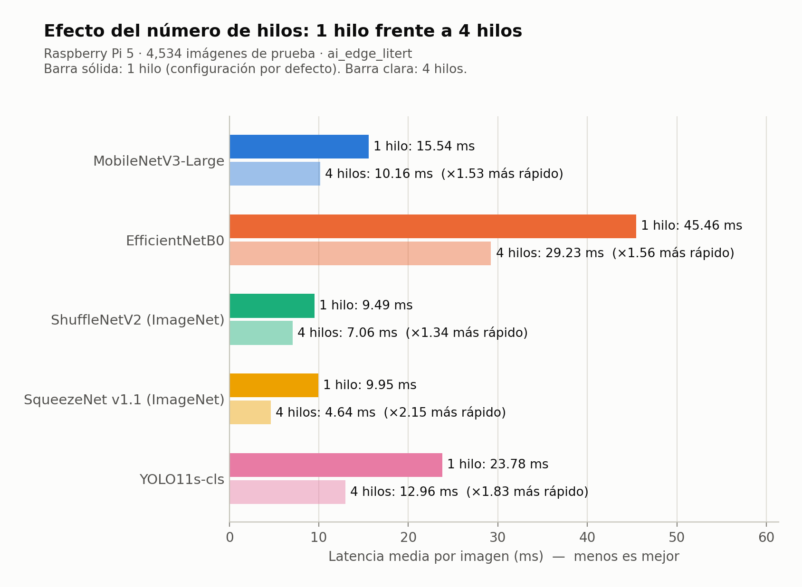

- Con cuatro veces más núcleos, la latencia mejora entre 1.34 y 2.15 veces. Los modelos con convoluciones densas (SqueezeNet ×2.15 y YOLO11s-cls ×1.83) se reparten mejor entre hilos que los que se basan en convoluciones *depthwise* (ShuffleNetV2, MobileNetV3-Large y EfficientNetB0, de ×1.34 a ×1.56).
- El precio es alto: la CPU pasa de 25% a más de 90% (los cuatro núcleos ocupados), en tres modelos la desviación estándar de la latencia crece más de 8 veces y aparecen picos de hasta 68 ms. La temperatura máxima llegó a 69.4 °C, todavía lejos de los 80 °C.
- Las predicciones son idénticas con 1 y con 4 hilos (0 diferencias en las 4,534 imágenes de cada modelo) y tampoco hubo throttling (`0x0`).
- **Para el despliegue se recomienda 1 hilo:** con un núcleo, todos los modelos menos EfficientNetB0 superan los 30 cuadros/s de una cámara típica, y quedan libres tres núcleos para el resto del sistema. Usar 4 hilos solo tendría sentido si se necesitara exprimir el rendimiento total; con 4 hilos, YOLO11s-cls (12.96 ms) sería incluso más rápido que MobileNetV3-Large con uno.

---

## 9. Conclusiones y recomendación

1. **Los cinco modelos son viables en la Raspberry Pi 5:** todos cumplen H1 con amplio margen (×4.0 a ×17.2 en el peor caso), son estables en ejecución continua y no provocan throttling.
2. **YOLO11s-cls es el más preciso:** 97.44% de accuracy, con una ventaja significativa sobre los otros cuatro modelos, y el mejor en cuatro de las cinco clases. Su latencia (23.8 ms, 42 cuadros/s) es mayor que la de ShuffleNetV2, SqueezeNet y MobileNetV3-Large, pero la mitad que la de EfficientNetB0.
3. **MobileNetV3-Large es el mejor equilibrio entre los modelos de Keras:** iguala en precisión a EfficientNetB0 (p = 0.51) con la tercera parte de su latencia y la mitad de su RAM.
4. **EfficientNetB0 ya no tiene un caso de uso:** YOLO11s-cls lo supera en precisión y en velocidad, y MobileNetV3-Large lo iguala en precisión con un tercio de la latencia.
5. **ShuffleNetV2 y SqueezeNet v1.1 solo se justificarían en hardware más limitado.** Son los más rápidos (~10 ms) y ligeros, pero pierden entre 2.3 y 5.7 puntos de precisión frente a los mejores, y en la Pi 5 esa velocidad extra no hace falta. Entre los dos, ShuffleNetV2 es claramente mejor: misma velocidad y 110 errores menos.
6. **Las métricas deben medirse en el dispositivo final:** el número de operaciones no predice la latencia en la Raspberry. YOLO11s-cls hace 4 veces más operaciones que EfficientNetB0 y es dos veces más rápido.

**Recomendación: MobileNetV3-Large.** De los cinco modelos es el que mejor equilibra precisión, velocidad y consumo: 96.47% de accuracy, 15.54 ms por imagen (64 cuadros/s) y 17 MB de RAM, con el doble de los 30 cuadros/s de una cámara típica. YOLO11s-cls es 0.97 puntos más preciso, pero cuesta 53% más tiempo de CPU por imagen, 27% más RAM y un preprocesamiento distinto que recorta los bordes de la imagen. MobileNetV3-Large conserva la mayor holgura de CPU para la cámara, la interfaz y los actuadores, y recibe la imagen completa. YOLO11s-cls queda como alternativa si en las pruebas del sistema completo la precisión resulta ser el factor limitante.

Texto sugerido para la tesina:

> *En la Raspberry Pi 5 se compararon cinco clasificadores ligeros sobre 4,534 imágenes de prueba. MobileNetV3-Large alcanzó 96.47% de exactitud, sin diferencia significativa frente a EfficientNetB0 (96.67%; McNemar p = 0.51), con una latencia media de 15.54 ms (P95 15.61 ms), 2.9 veces menor que la de EfficientNetB0. YOLO11s-cls obtuvo la mayor exactitud (97.44%, diferencia significativa con corrección de Holm), pero con una latencia 1.5 veces mayor (23.78 ms) y un preprocesamiento que recorta la imagen. MobileNetV3-Large cumple la hipótesis H1 (< 200 ms) con un margen de 10.9 veces en el peor caso y, durante 5 minutos de inferencia continua, no presentó deriva de latencia, crecimiento de memoria ni reducción de frecuencia por temperatura (máx. 60.6 °C). Por su equilibrio entre precisión, velocidad y consumo de recursos se selecciona MobileNetV3-Large para el despliegue.*

---

## 10. Evidencias generadas

Todas provienen de la ejecución en la Raspberry Pi 5.

**Gráficas** (`reports/figures/raspberry5_5modelos/`):

| Archivo | Contenido |
|---|---|
| `01_accuracy_modelos.png` | Accuracy de cada modelo con su intervalo de confianza del 95% |
| `02_accuracy_por_clase.png` | Accuracy por clase y modelo |
| `03_matrices_confusion.png` | Matrices de confusión de los cinco modelos |
| `04_latencia_media.png` | Latencia media y cuadros por segundo |
| `05_latencia_vs_limite_H1.png` | Peor latencia de cada modelo frente al límite de 200 ms |
| `06_distribucion_latencia.png` | Histograma de la latencia por imagen con percentiles |
| `07_latencia_por_imagen.png` | Latencia de cada una de las 4,534 inferencias |
| `08_estabilidad_series.png` | Latencia, CPU, temperatura y RAM durante 5 minutos continuos |
| `09_precision_vs_latencia.png` | Compromiso precisión–velocidad–tamaño |
| `10_recursos.png` | Tamaño, RAM, CPU, inferencias/s, temperatura y tiempo de carga |
| `11_latencia_1_vs_4_hilos.png` | Efecto de usar 4 hilos de inferencia |
| `12_ejemplos_predicciones.png` | Imágenes de prueba con la predicción de cada modelo |
| `13_errores_comunes.png` | Imágenes que los cinco modelos clasificaron mal |
| `14_coincidencia_errores.png` | Cuántos errores comparten los modelos |

La selección de imágenes de los mosaicos está en `reports/benchmark_rpi5_5modelos/seleccion_mosaicos.json`.

**Capturas de pantalla del proceso** (`reports/figures/raspberry5_5modelos/capturas/`). Son las pantallas de `benchmark_visual.py` tal como se vieron en la terminal de la Raspberry durante la corrida oficial; los SVG originales están en `reports/benchmark_rpi5_5modelos/capturas_svg/`.

| Archivo | Etapa |
|---|---|
| `captura_0a_sistema_y_modelos.png` | Ficha del dispositivo y de los cinco modelos |
| `captura_0b_imagenes_de_prueba.png` | Distribución de las imágenes de prueba |
| `captura_1a` a `captura_5a_latencia_*.png` | Prueba de latencia y precisión de cada modelo (al terminar) |
| `captura_1b` a `captura_5b_estabilidad_*.png` | Monitor de estabilidad de cada modelo (al terminar los 5 min) |
| `captura_1c` a `captura_5c_resumen_*.png` | Tabla de resumen y matriz de confusión de cada modelo |
| `captura_9a_comparacion_final.png` | Tabla comparativa final |
| `captura_9b_accuracy_por_clase.png` | Accuracy por clase |

**Capturas del escritorio de la Raspberry** (`reports/figures/raspberry5_5modelos/escritorio/`). Son capturas de pantalla reales (`grim`, 1920×1080) del escritorio de la Raspberry Pi mientras `benchmark_visual.py` corría en una terminal. Corresponden a una ejecución de demostración del 17/10/2026 a las 18:57, con 1,500 imágenes y 30 s de estabilidad (datos: `reports/benchmark_rpi5_5modelos/resultados_rpi5_5modelos_demo_escritorio.json`). Durante esa ejecución la terminal redibujaba la pantalla y se tomaba una captura cada 4 s, así que la latencia que aparece es un poco mayor (~16.6 ms en MobileNetV3-Large y ~24.9 ms en YOLO11s-cls) que la de la corrida oficial. **Para la tesina, las cifras oficiales son las de las secciones 3 a 8.**

| Archivo | Momento |
|---|---|
| `escritorio_1_inicio_sistema_y_modelos.png` | Inicio: ficha del dispositivo, modelos a evaluar y carga de los dos juegos de imágenes |
| `escritorio_2_latencia_mobilenet.png` | MobileNetV3-Large clasificando imágenes en vivo |
| `escritorio_3_estabilidad_mobilenet.png` | Monitor de estabilidad (CPU por núcleo, RAM, temperatura, frecuencia) |
| `escritorio_4_latencia_yolo.png` | YOLO11s-cls clasificando imágenes en vivo |
| `escritorio_5_comparacion_final.png` | Tablas comparativas al terminar |

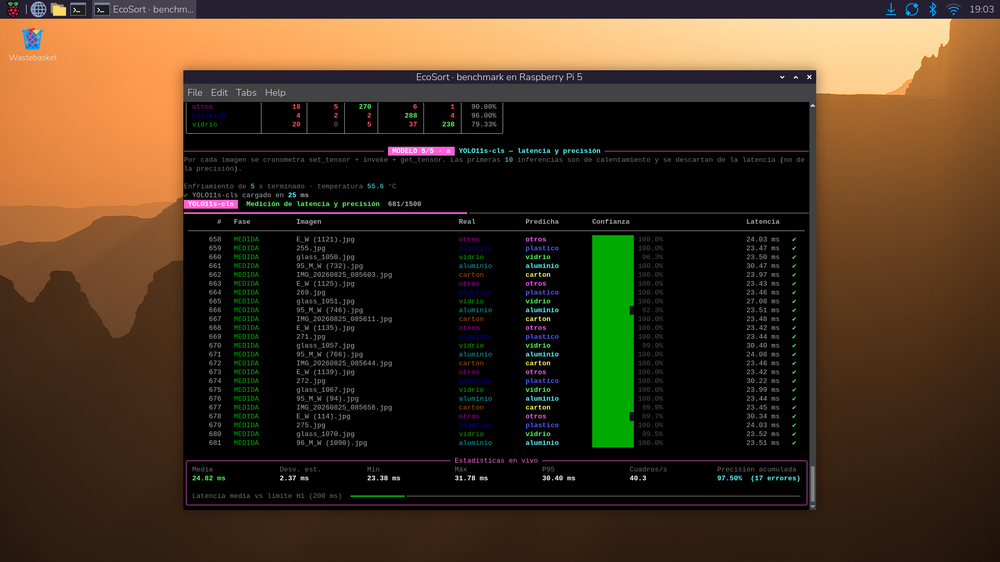

---

## 11. Cómo reproducir las pruebas

En la Raspberry Pi (carpeta `~/ecosort_benchmark/` con `benchmark_visual.py`, `modelos/` con los cinco `.tflite` y `test_set/`):

```bash
# Requisitos (ya instalados): pip install ai-edge-litert numpy pillow psutil rich
python3 benchmark_visual.py --salida-dir resultados_5modelos_1hilo          # corrida oficial (~40 min)
python3 benchmark_visual.py --num-threads 4 --duracion-estabilidad 120 \
        --salida-dir resultados_5modelos_4hilos                            # prueba con 4 hilos (~22 min)
python3 benchmark_visual.py --max-imagenes 1500 --duracion-estabilidad 30 \
        --enfriamiento 5                                                   # demostración corta para video
```

Cada corrida crea su carpeta con `resultados.json` y `capturas/*.svg`. En la laptop:

```bash
# Copiar los resultados de la Raspberry
scp pi-companera:ecosort_benchmark/resultados_5modelos_1hilo/resultados.json \
    reports/benchmark_rpi5_5modelos/resultados_rpi5_5modelos_1hilo.json
scp pi-companera:ecosort_benchmark/resultados_5modelos_4hilos/resultados.json \
    reports/benchmark_rpi5_5modelos/resultados_rpi5_5modelos_4hilos.json
scp 'pi-companera:ecosort_benchmark/resultados_5modelos_1hilo/capturas/*.svg' \
    reports/benchmark_rpi5_5modelos/capturas_svg/

# Generar gráficas y convertir capturas a PNG (requiere rsvg-convert)
venv/bin/python pruebas_modelos/reportes/graficar_benchmark_rpi.py \
    --resultados reports/benchmark_rpi5_5modelos/resultados_rpi5_5modelos_1hilo.json \
    --resultados-hilos reports/benchmark_rpi5_5modelos/resultados_rpi5_5modelos_4hilos.json \
    --capturas reports/benchmark_rpi5_5modelos/capturas_svg \
    --seleccion reports/benchmark_rpi5_5modelos/seleccion_mosaicos.json \
    --salida reports/figures/raspberry5_5modelos
```

Scripts:

- `pruebas_modelos/raspberry/benchmark_visual.py`: benchmark visual de los cinco modelos. Cada modelo declara el orden de los ejes de su entrada, la escala de los pixeles y su preprocesamiento; el script carga un juego de imágenes por cada preprocesamiento. La versión anterior, de tres modelos, quedó en la Raspberry como `benchmark_visual_v2_3modelos.py.bak`.
- `pruebas_modelos/reportes/graficar_benchmark_rpi.py`: genera las gráficas y convierte las capturas.
- `pruebas_modelos/reportes/generar_pdf_reporte.py`: convierte este reporte a PDF.
