# Reporte de pruebas: MobileNetV3-Large, EfficientNetB0 y ShuffleNetV2 (ImageNet)

Comparación de los tres clasificadores ligeros de residuos (5 clases: `aluminio`, `carton`, `otros`, `plastico`, `vidrio`) en dos entornos:

1. **Laptop de desarrollo**: evaluación de los modelos `.keras` en GPU y de los modelos `.tflite` en CPU.
2. **Raspberry Pi 5**: el dispositivo de despliegue. Se evaluaron los modelos `.tflite`, es decir, los mismos archivos que se instalarían en el sistema final.

Las gráficas y capturas de evidencia (carpeta `reports/figures/raspberry/`) provienen **solo de las pruebas en la Raspberry Pi**. Los resultados de la laptop aparecen únicamente en las tablas de este reporte, como referencia.

Fecha de las pruebas: 13 de octubre de 2026.

---

## 1. Resumen

| Modelo | Accuracy en RPi | Errores | F1 macro | Latencia media en RPi | Cuadros/s | RAM del modelo | `.tflite` |
|---|---|---|---|---|---|---|---|
| **MobileNetV3-Large** | 96.47% | 160 / 4,534 | 0.9627 | **15.50 ms** | 64.5 | 17.1 MB | 3.24 MB |
| EfficientNetB0 | **96.67%** | 151 / 4,534 | **0.9648** | 45.40 ms | 22.0 | 34.2 MB | 4.50 MB |
| ShuffleNetV2 (ImageNet) | 94.18% | 264 / 4,534 | 0.9381 | **9.35 ms** | 106.9 | **12.2 MB** | **1.50 MB** |

- **Precisión:** MobileNetV3-Large y EfficientNetB0 son estadísticamente equivalentes (9 imágenes de diferencia; prueba de McNemar p = 0.51). ShuffleNetV2 comete unos 100 errores más y esa diferencia sí es significativa (p < 10⁻¹¹).
- **Velocidad en la Raspberry:** EfficientNetB0 es **2.9 veces más lento** que MobileNetV3-Large (45.4 ms frente a 15.5 ms). En la GPU de la laptop ambos parecían igual de rápidos (8.1 y 8.5 ms), así que la latencia medida en la laptop no sirve para predecir la del dispositivo.
- **Hipótesis H1 (latencia < 200 ms):** los tres modelos la cumplen con amplio margen. Incluso el peor caso del modelo más lento (46.0 ms) queda 4.4 veces por debajo del límite.
- **Estabilidad:** en 5 minutos de inferencia continua por modelo no hubo deriva de latencia (≤ 0.01%), ni aumento de RAM (0.0 MB), ni throttling o bajo voltaje (`0x0`). La CPU se mantuvo fija a 2400 MHz y la temperatura máxima fue de 57.9 °C.
- **Cuantización y cambio de dispositivo:** al pasar del `.keras` en la laptop al `.tflite` en la Raspberry, la precisión cambia como máximo 0.15 puntos porcentuales.

**Modelo recomendado para el despliegue: MobileNetV3-Large.** Iguala en precisión a EfficientNetB0 con la tercera parte de su latencia y la mitad de su memoria. ShuffleNetV2 es 1.66 veces más rápido, pero esa velocidad extra no se aprovecha: MobileNetV3 ya procesa 64 cuadros/s, más que los 30 cuadros/s de una cámara típica. A cambio, ShuffleNetV2 pierde 2.3 puntos de precisión.

---

## 2. Entorno de pruebas

| | Laptop (desarrollo) | Raspberry Pi 5 (despliegue) |
|---|---|---|
| Procesador | AMD Ryzen 7 7435HS (8 núcleos / 16 hilos) | Broadcom BCM2712, 4 × Cortex-A76 a 2.4 GHz |
| GPU | NVIDIA RTX 4050 Laptop (6 GB) | no se usa |
| RAM | 16 GB | 16 GB |
| Sistema | CachyOS, kernel 7.2.6 | Debian 13 (trixie), kernel 6.18.50+rpt-rpi-2712 |
| Python | 3.12.14 | 3.13.5 |
| Runtime | TensorFlow 2.21.0 / Keras 3.13.1 (`.keras` en GPU), `tf.lite` (`.tflite` en CPU) | `ai-edge-litert` 2.2.0 (`.tflite` en CPU) |
| Hilos de inferencia | 1 (valor por defecto del intérprete) | 1 (valor por defecto); también se probó con 4 (sección 6) |
| Gobernador de CPU | — | `ondemand` |

**Conjunto de prueba:** `data/raw/waste_classification/test`, con **4,534 imágenes**: aluminio 888, cartón 730, otros 1,164, plástico 1,268 y vidrio 484. Son las mismas imágenes que usan los notebooks de evaluación. Se excluyen 3 archivos con formatos que Keras no lee (`.gif`, `.HEIC` y `.webp`), igual que hace `ImageDataGenerator`.

**Preprocesamiento:** el mismo que en el entrenamiento: conversión a RGB, redimensionado a 224×224 con interpolación *nearest* (como `flow_from_directory`) y pixeles `float32` en rango 0-255. Los tres modelos traen la normalización dentro de la red.

**Modelos evaluados:**

| Modelo | `.keras` | `.tflite` (cuantización de rango dinámico) |
|---|---|---|
| MobileNetV3-Large | `modelo_residuos_rpi_V3_05.keras` (32.47 MB) | `modelo_residuos_rpi_V3_05.tflite` (3.24 MB) |
| EfficientNetB0 | `modelo_residuos_EfficientNetB0_v1.keras` (41.67 MB) | `modelo_residuos_EfficientNetB0_v1.tflite` (4.50 MB) |
| ShuffleNetV2 (ImageNet) | `modelo_residuos_shufflenetV2_imagenet.keras` (14.63 MB) | `modelo_residuos_shufflenetV2_imagenet.tflite` (1.50 MB) |

---

## 3. Resultados en la laptop

Estos resultados sirven de referencia. No forman parte de la evidencia gráfica.

### 3.1 Modelos `.keras` en GPU (`tests/comparar_modelos_inferencia.py`)

| Modelo | Accuracy | Loss | Errores | F1 macro | Precisión macro | Recall macro | Latencia* |
|---|---|---|---|---|---|---|---|
| MobileNetV3-Large | 96.52% | 0.1284 | 158 / 4,534 | 0.9636 | 0.9658 | 0.9617 | 8.5 ms |
| EfficientNetB0 | 96.63% | 0.1211 | 153 / 4,534 | 0.9642 | 0.9647 | 0.9640 | 8.1 ms |
| ShuffleNetV2 (ImageNet) | 94.33% | 0.1784 | 257 / 4,534 | 0.9399 | 0.9428 | 0.9377 | 5.9 ms |
| *ShuffleNetV2 (desde cero, referencia)* | *81.32%* | *0.5635* | *847 / 4,534* | *0.8034* | *0.8053* | *0.8112* | *7.0 ms* |

\* Latencia en la RTX 4050 por lotes; no es comparable con la de la Raspberry.

Accuracy por clase (`.keras`, laptop):

| Clase | MobileNetV3-Large | EfficientNetB0 | ShuffleNetV2 (ImageNet) | ShuffleNetV2 (desde cero) |
|---|---|---|---|---|
| aluminio | 97.86% | 97.64% | 95.50% | 84.23% |
| carton | 97.26% | 98.90% | 97.40% | 81.10% |
| otros | 97.77% | 96.65% | 95.62% | 88.83% |
| plastico | 95.58% | 96.06% | 93.38% | 73.97% |
| vidrio | 92.36% | 92.77% | 86.98% | 77.48% |

El preentrenamiento en ImageNet subió a ShuffleNetV2 de 81.32% a 94.33%, con 70% menos errores.

### 3.2 Modelos `.tflite` en CPU (`tests/benchmark_visual.py` en la laptop)

| Modelo | Accuracy | Errores | F1 macro | Latencia media | P95 | RAM del modelo |
|---|---|---|---|---|---|---|
| MobileNetV3-Large | 96.27% | 169 / 4,534 | 0.9605 | 7.16 ms | 7.64 ms | 17.2 MB |
| EfficientNetB0 | 96.56% | 156 / 4,534 | 0.9638 | 15.33 ms | 16.07 ms | 34.3 MB |
| ShuffleNetV2 (ImageNet) | 94.29% | 259 / 4,534 | 0.9395 | 4.87 ms | 5.05 ms | 12.7 MB |

Datos crudos: `reports/benchmark_laptop/resultados_laptop_tflite.json`.

---

## 4. Resultados en la Raspberry Pi 5

Corrida oficial: `tests/benchmark_visual.py` con los parámetros por defecto (todas las imágenes, 10 inferencias de calentamiento, 5 minutos de estabilidad por modelo y 60 s de enfriamiento antes de cada modelo). Duró 24 min 11 s, del 13/10/2026 20:44 a las 21:08. Datos crudos: `reports/benchmark_rpi/resultados_rpi_1hilo.json`; registro de la terminal: `reports/benchmark_rpi/log_rpi_1hilo.txt`.

### 4.1 Precisión de clasificación

| Modelo | Accuracy | IC 95% (Wilson) | Errores | Precisión macro | Recall macro | F1 macro |
|---|---|---|---|---|---|---|
| MobileNetV3-Large | 96.47% | 95.89 – 96.97% | 160 | 0.9650 | 0.9608 | 0.9627 |
| EfficientNetB0 | 96.67% | 96.11 – 97.15% | 151 | 0.9650 | 0.9646 | 0.9648 |
| ShuffleNetV2 (ImageNet) | 94.18% | 93.46 – 94.82% | 264 | 0.9402 | 0.9366 | 0.9381 |

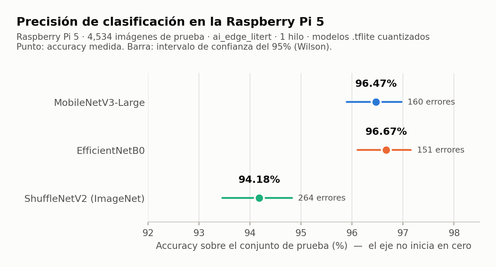

**Significancia estadística (prueba de McNemar exacta, mismas 4,534 imágenes):**

| Comparación | Solo acierta el primero | Solo acierta el segundo | p | ¿Diferencia significativa? |
|---|---|---|---|---|
| MobileNetV3-Large vs EfficientNetB0 | 68 | 77 | 0.51 | No |
| MobileNetV3-Large vs ShuffleNetV2 | 161 | 57 | 1.1 × 10⁻¹² | Sí |
| EfficientNetB0 vs ShuffleNetV2 | 167 | 54 | 1.3 × 10⁻¹⁴ | Sí |

**Accuracy por clase:**

| Clase (n) | MobileNetV3-Large | EfficientNetB0 | ShuffleNetV2 (ImageNet) |
|---|---|---|---|
| aluminio (888) | **97.86%** | 97.52% | 95.50% |
| carton (730) | 97.53% | **98.36%** | 97.40% |
| otros (1,164) | **97.68%** | 97.08% | 95.27% |
| plastico (1,268) | 95.58% | **95.98%** | 93.14% |
| vidrio (484) | 91.74% | **93.39%** | 86.98% |

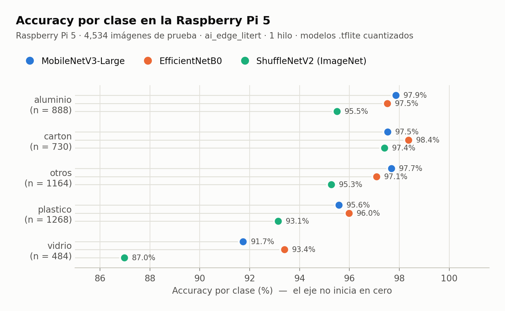

**Matrices de confusión** (filas = clase real, columnas = clase predicha; orden aluminio, carton, otros, plastico, vidrio):

```
MobileNetV3-Large            EfficientNetB0               ShuffleNetV2 (ImageNet)
[ 869    1    9    7    2]   [ 866    6    7    7    2]   [ 848    6   20    7    7]
[   6  712    9    3    0]   [   4  718    6    1    1]   [   9  711    5    5    0]
[  11   10 1137    6    0]   [  12   10 1130   10    2]   [  17   11 1109   18    9]
[  19    8   16 1212   13]   [  17    8   10 1217   16]   [  33    9   26 1181   19]
[   8    1    9   22  444]   [   5    0    5   22  452]   [  11    2   15   35  421]
```

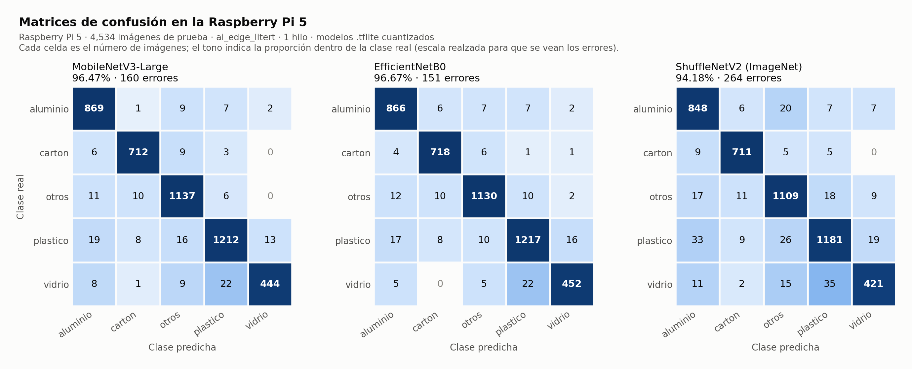

**Observaciones:**

- `vidrio` es la clase más difícil para los tres modelos, y su error principal es confundirse con `plastico` (22, 22 y 35 casos). Ambos materiales son transparentes y se parecen en las fotos. Además, `vidrio` tiene menos imágenes (484).
- ShuffleNetV2 pierde precisión en todas las clases menos en `carton`, donde queda a la par de MobileNetV3 (97.40% frente a 97.53%).
- De las 4,534 imágenes, 4,173 las aciertan los tres modelos, 216 las falla solo uno, 76 las fallan dos y **69 las fallan los tres**. Estas últimas son casos ambiguos más que defectos de un modelo en particular: envolturas metalizadas y bolsas arrugadas que se confunden con cartón, aluminio u otros; objetos pequeños sobre fondos con textura; vidrio roto que parece plástico, o collages con varios objetos (figuras 13 y 14).

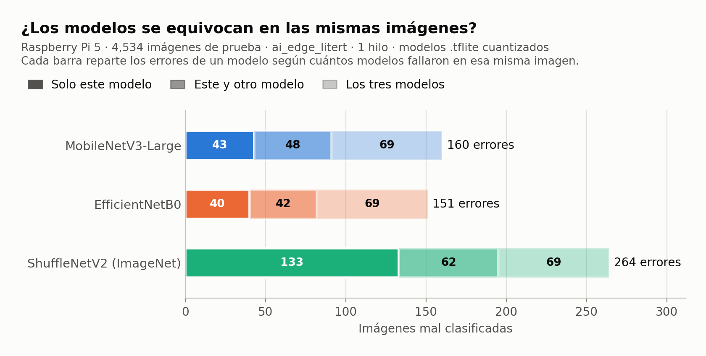

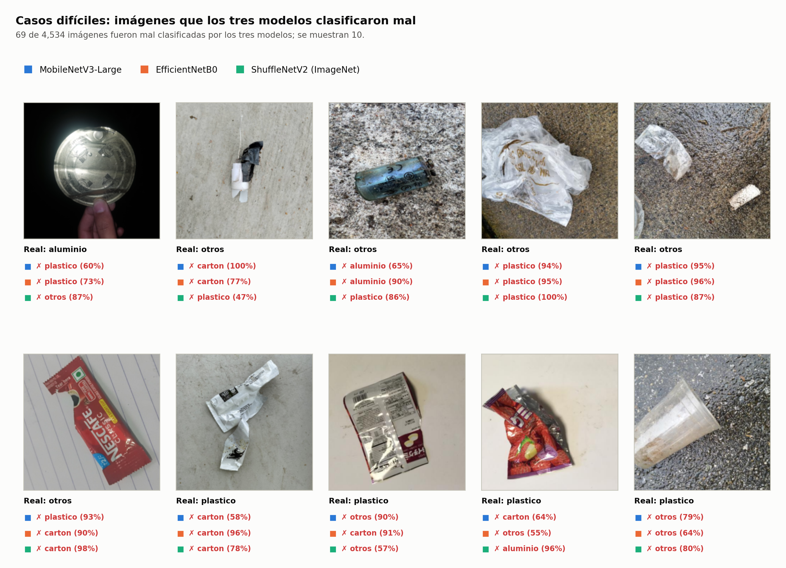

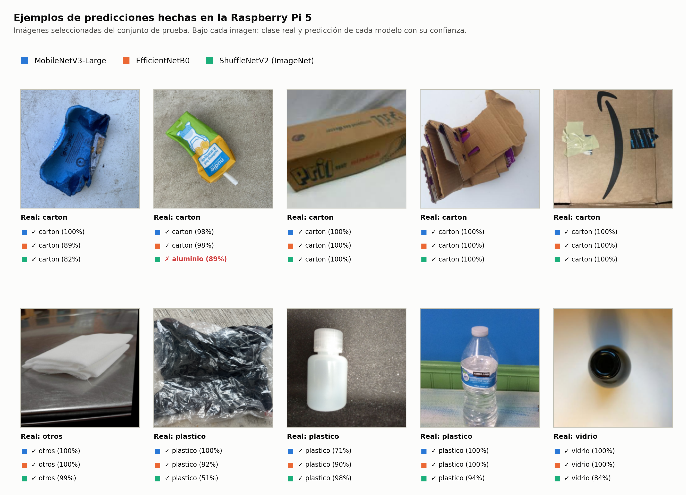

### 4.2 Latencia de inferencia

Se cronometra `set_tensor + invoke + get_tensor` de cada imagen y se descartan las primeras 10 inferencias como calentamiento, así que cada modelo tiene 4,524 mediciones.

| Modelo | Media | Desv. est. | Mín | P50 | P95 | P99 | Máx | Cuadros/s | Margen frente a H1 (peor caso) |
|---|---|---|---|---|---|---|---|---|---|
| MobileNetV3-Large | 15.50 ms | 0.06 | 15.41 | 15.49 | 15.57 | 15.61 | 17.87 | 64.5 | ×11.2 |
| EfficientNetB0 | 45.40 ms | 0.06 | 45.23 | 45.39 | 45.50 | 45.59 | 45.97 | 22.0 | ×4.4 |
| ShuffleNetV2 (ImageNet) | 9.35 ms | 0.03 | 9.29 | 9.35 | 9.40 | 9.46 | 9.63 | 106.9 | ×20.8 |

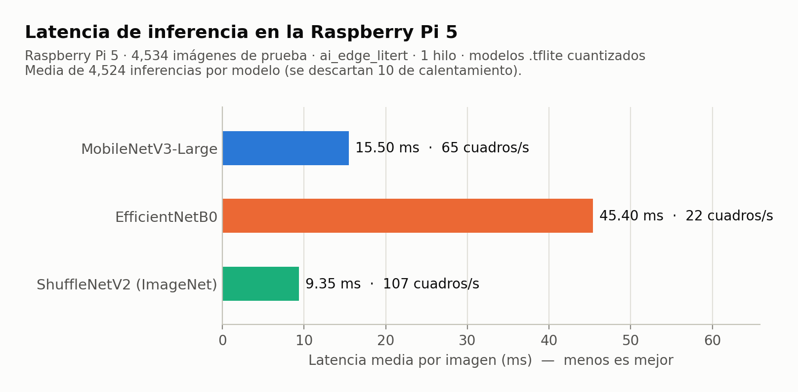

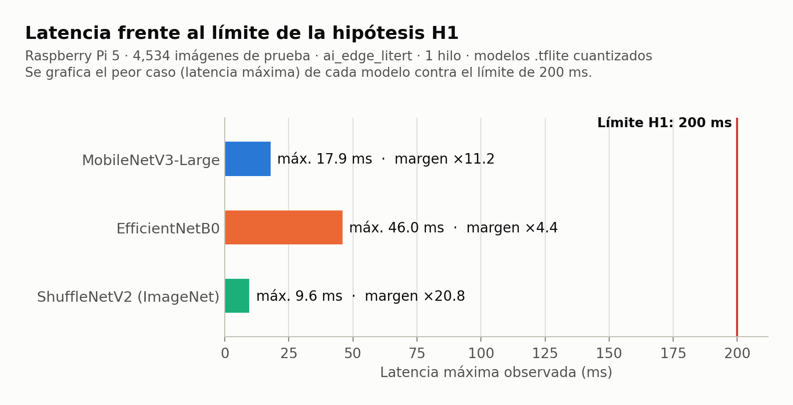

La latencia es muy estable: la desviación estándar no pasa de 0.06 ms y el P99 queda a menos de 0.2 ms de la media.

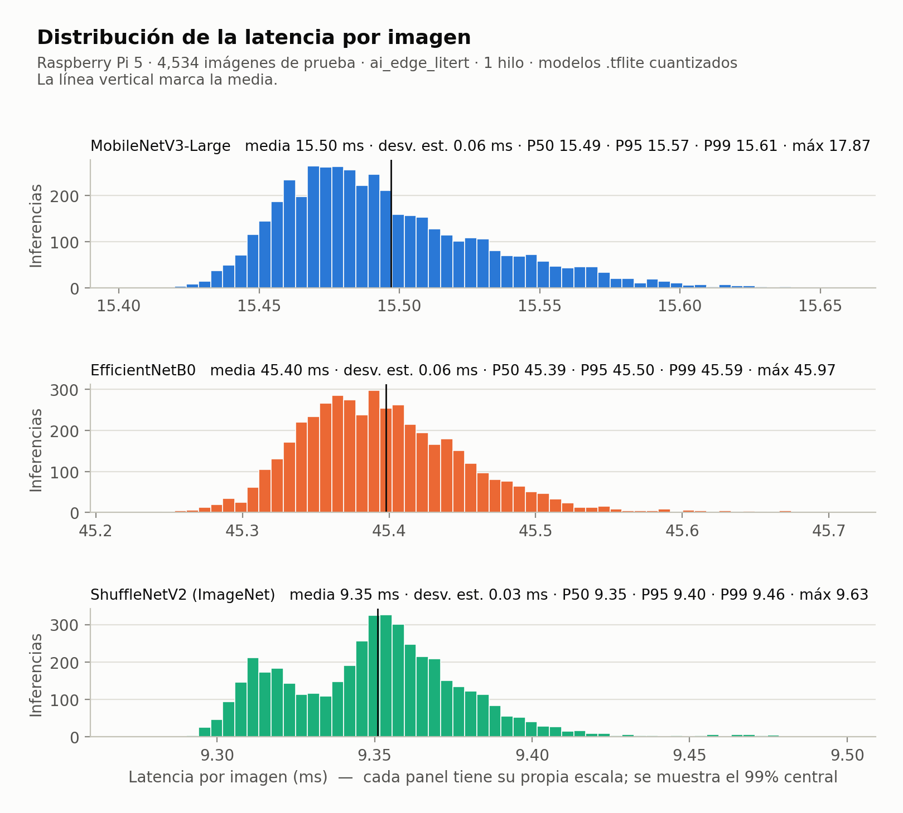

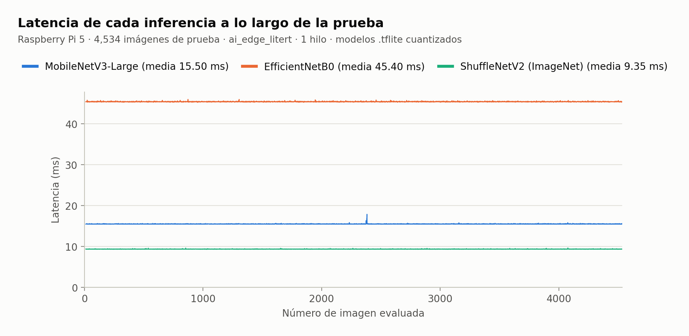

**Repetibilidad:** el 17/09/2026, con `benchmark_rpi.py` y 200 imágenes, MobileNetV3-Large había dado 15.67 ms; hoy, con 4,534 imágenes, dio 15.50 ms (1% de diferencia).

**Costo del preprocesamiento:** decodificar y redimensionar las imágenes del set de prueba (JPEG/PNG de tamaños variados, por ejemplo 1920×1024) tomó 37.3 s para 4,534 imágenes, unos 8.2 ms por imagen. Esto queda fuera de la latencia medida, pero en el sistema final se suma a la inferencia. Con la cámara el costo debería ser menor, porque los cuadros ya llegan con resolución reducida.

### 4.3 Estabilidad (5 minutos de inferencia continua por modelo)

| Modelo | Inferencias | Inf/s | CPU media (máx) | Deriva de latencia | Δ RAM | Temp. media / máx | Frecuencia | Throttling |
|---|---|---|---|---|---|---|---|---|
| MobileNetV3-Large | 19,158 | 63.9 | 25.0% (27.3%) | 0.00% | 0.00 MB | 55.8 / 57.9 °C | 2400 MHz fija | ninguno (`0x0`) |
| EfficientNetB0 | 6,566 | 21.9 | 25.2% (45.4%) | −0.01% | 0.00 MB | 52.5 / 57.3 °C | 2400 MHz fija | ninguno (`0x0`) |
| ShuffleNetV2 (ImageNet) | 31,570 | 105.2 | 25.1% (25.4%) | +0.01% | 0.00 MB | 43.8 / 45.2 °C | 2400 MHz fija | ninguno (`0x0`) |

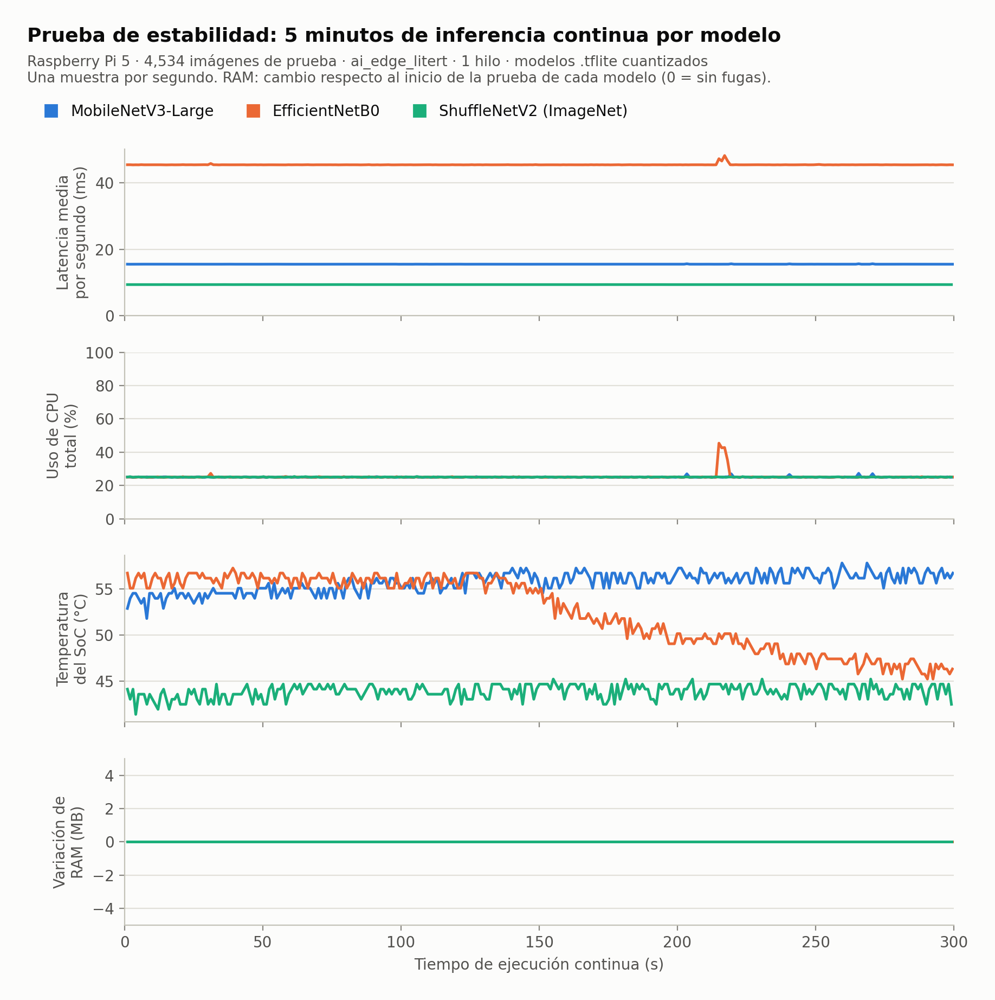

- **CPU al 25%:** con un hilo, el intérprete ocupa uno de los 4 núcleos al 100% y deja libres los otros tres para la cámara, la interfaz y el control de actuadores. El pico de 45.4% de EfficientNetB0 duró unos 4 segundos, alrededor del segundo 215, y coincide con un repunte de latencia a 48 ms. Como el benchmark usa un solo hilo, lo más probable es que fuera otro proceso del sistema compitiendo por la CPU.
- **Temperatura:** las diferencias entre modelos dependen sobre todo del ventilador activo de la Raspberry y no del modelo. Los tres modelos usan el mismo núcleo al 100% y el ventilador se enciende y apaga por umbrales. En todos los casos quedó muy por debajo de los 80 °C en que el SoC empieza a reducir la frecuencia.
- **RAM:** la memoria del proceso no cambió ni un kilobyte durante las pruebas, así que no hay fugas.

### 4.4 Consumo de recursos

| Modelo | `.tflite` | RAM del modelo cargado* | Tiempo de carga | CPU en inferencia continua |
|---|---|---|---|---|
| MobileNetV3-Large | 3.24 MB | 17.1 MB | 14.6 ms | 25.0% |
| EfficientNetB0 | 4.50 MB | 34.2 MB | 19.8 ms | 25.2% |
| ShuffleNetV2 (ImageNet) | 1.50 MB | 12.2 MB | 8.5 ms | 25.1% |

\* Medida en un proceso aislado: la RAM del proceso con el modelo cargado y 30 inferencias ejecutadas, menos la del proceso vacío (42 MB, Python + numpy + runtime).

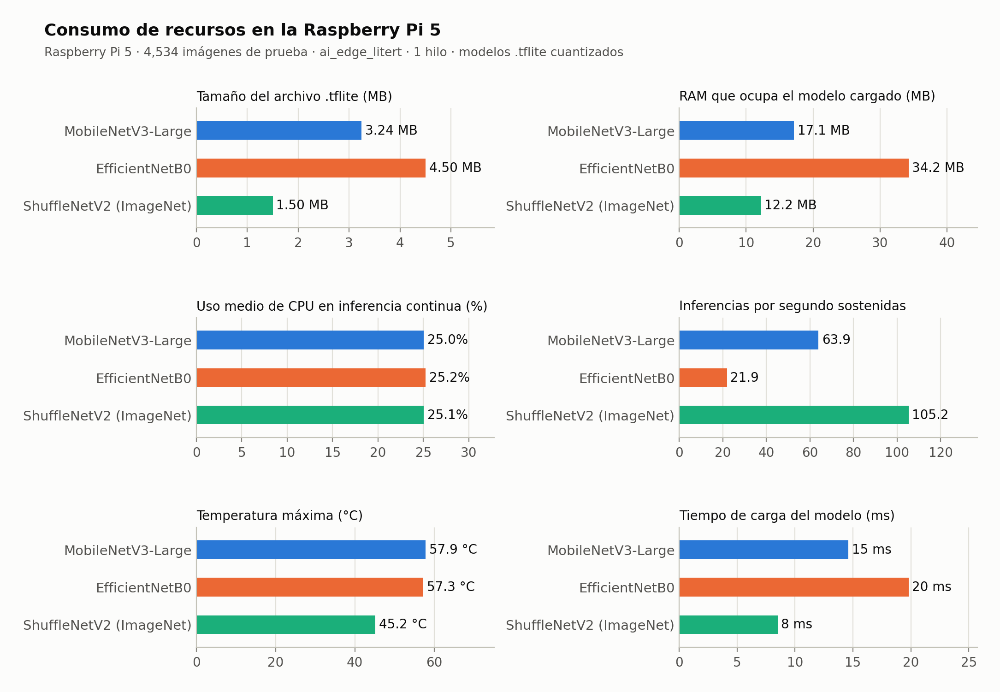

### 4.5 Compromiso entre precisión y velocidad

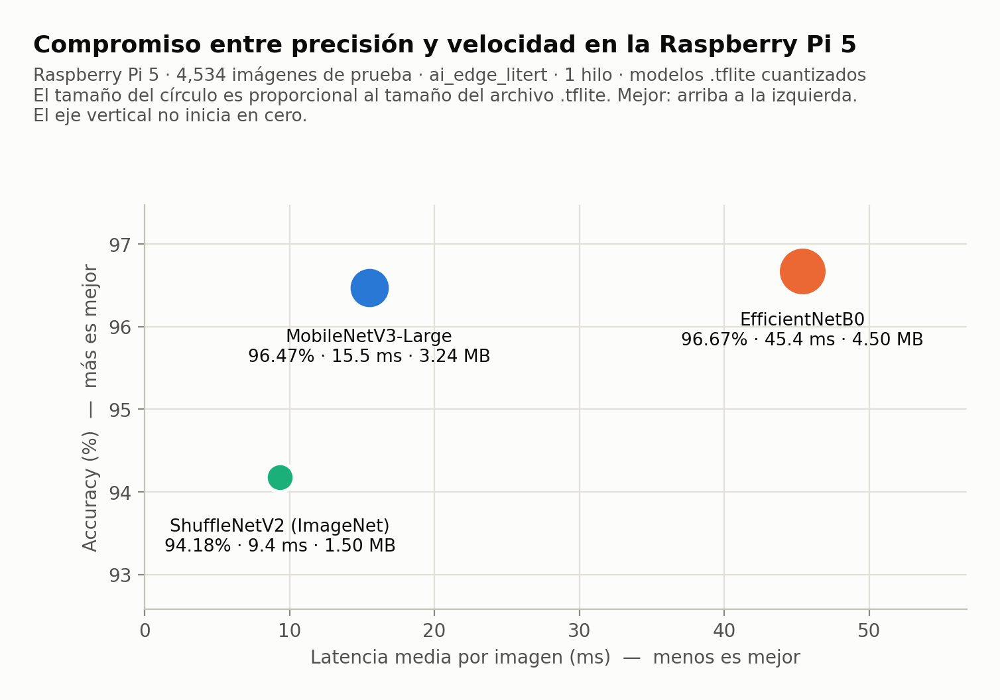

---

## 5. Laptop frente a Raspberry Pi

### 5.1 Precisión: efecto de la cuantización y del dispositivo

| Modelo | `.keras` laptop (GPU) | `.tflite` laptop (CPU x86) | `.tflite` Raspberry (CPU ARM) | Cambio `.keras` → RPi |
|---|---|---|---|---|
| MobileNetV3-Large | 96.52% (158 err.) | 96.27% (169 err.) | 96.47% (160 err.) | −0.05 pp |
| EfficientNetB0 | 96.63% (153 err.) | 96.56% (156 err.) | 96.67% (151 err.) | +0.04 pp |
| ShuffleNetV2 (ImageNet) | 94.33% (257 err.) | 94.29% (259 err.) | 94.18% (264 err.) | −0.15 pp |

- La cuantización a `.tflite` reduce el tamaño entre 9 y 10 veces y casi no afecta la precisión: menos de 0.3 puntos en cualquier entorno.
- **El mismo `.tflite` da algunas predicciones distintas en la laptop y en la Raspberry:** 26 imágenes en MobileNetV3, 16 en EfficientNetB0 y 10 en ShuffleNetV2. Se verificó que los pixeles de entrada son idénticos en los dos equipos (0 de 49 imágenes con diferencias tras decodificar y redimensionar). Por lo tanto, la diferencia viene del runtime: `tf.lite` en x86 y `ai-edge-litert` en ARM usan kernels distintos para las capas con cuantización dinámica, y los redondeos cambian la predicción en imágenes que estaban en la frontera entre dos clases. El efecto neto es de ±0.2 puntos, dentro del intervalo de confianza. Por eso **las cifras oficiales para la tesina deben ser las medidas en la Raspberry.**

### 5.2 Latencia

| Modelo | `.keras` laptop (GPU, por lotes) | `.tflite` laptop (CPU, 1 hilo) | `.tflite` Raspberry (CPU, 1 hilo) | RPi / laptop CPU |
|---|---|---|---|---|
| MobileNetV3-Large | 8.5 ms | 7.16 ms | 15.50 ms | ×2.2 |
| EfficientNetB0 | 8.1 ms | 15.33 ms | 45.40 ms | ×3.0 |
| ShuffleNetV2 (ImageNet) | 5.9 ms | 4.87 ms | 9.35 ms | ×1.9 |

En la GPU, EfficientNetB0 parecía igual de rápido que MobileNetV3-Large, pero en la Raspberry es 2.9 veces más lento. La razón es su arquitectura. EfficientNetB0 hace casi el doble de operaciones (~0.39 GFLOPs frente a ~0.22) y su búsqueda de arquitectura optimizó FLOPs, con bloques *depthwise* de 5×5 y activaciones *swish*. La GPU absorbe ese trabajo en paralelo, pero un núcleo ARM lo paga completo. MobileNetV3, en cambio, se diseñó midiendo directamente la latencia en CPUs de teléfonos móviles. **Elegir un modelo con latencias de GPU habría llevado a una conclusión equivocada.**

---

## 6. Prueba complementaria: 4 hilos de inferencia

Por defecto el intérprete usa un solo hilo, así que ocupa uno de los cuatro núcleos. Para saber cuánto se gana repartiendo la inferencia entre los cuatro, se repitió la prueba con `--num-threads 4`: mismas 4,534 imágenes y 2 minutos de estabilidad por modelo. La corrida fue el 13/10/2026 de 21:08 a 21:22. Datos crudos: `reports/benchmark_rpi/resultados_rpi_4hilos.json`.

| Modelo | Latencia 1 hilo | Latencia 4 hilos | Aceleración | Desv. est. (1 → 4 hilos) | Máx 4 hilos | CPU 4 hilos | Temp. máx 4 hilos |
|---|---|---|---|---|---|---|---|
| MobileNetV3-Large | 15.50 ms | 10.02 ms | ×1.55 | 0.06 → 1.41 ms | 29.97 ms | 96.0% | 54.6 °C |
| EfficientNetB0 | 45.40 ms | 28.97 ms | ×1.57 | 0.06 → 1.27 ms | 46.35 ms | 96.3% | 61.7 °C |
| ShuffleNetV2 (ImageNet) | 9.35 ms | 6.97 ms | ×1.34 | 0.03 → 0.72 ms | 23.19 ms | 97.2% | 61.7 °C |

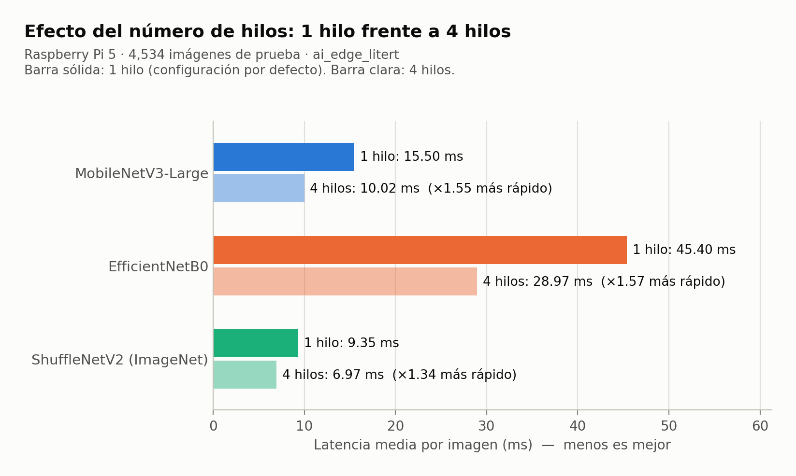

- Con cuatro veces más núcleos la latencia solo mejora entre 1.34 y 1.57 veces. Estas redes son pequeñas y gran parte del tiempo se va en sincronizar hilos y en capas que no se paralelizan bien.
- El precio es alto: la CPU pasa de 25% a ~96% (los cuatro núcleos ocupados), la desviación estándar de la latencia crece más de 20 veces y aparecen picos de hasta 30 ms. La temperatura máxima llegó a 61.7 °C, todavía lejos de los 80 °C.
- Las predicciones son idénticas con 1 y con 4 hilos (0 diferencias en las 4,534 imágenes de cada modelo) y tampoco hubo throttling (`0x0`).
- **Para el despliegue se recomienda 1 hilo.** MobileNetV3-Large ya procesa 64 cuadros/s con un núcleo y deja los otros tres para la cámara, la interfaz y los actuadores. Usar 4 hilos solo tendría sentido si se necesitara exprimir el rendimiento total.

---

## 7. Conclusiones

1. **Los tres modelos son viables en la Raspberry Pi 5:** todos cumplen H1 con amplio margen, son estables en ejecución continua y no provocan throttling.
2. **MobileNetV3-Large es el modelo recomendado.** Tiene la misma precisión que EfficientNetB0 (diferencia no significativa, p = 0.51), es 2.9 veces más rápido (15.5 frente a 45.4 ms), usa la mitad de RAM (17 frente a 34 MB) y su archivo es 28% más pequeño.
3. **EfficientNetB0 no compensa en el dispositivo:** sus 9 aciertos de más no son significativos y cuesta tres veces más tiempo de CPU.
4. **ShuffleNetV2 (ImageNet) es la opción para hardware más limitado.** Es el más rápido (9.35 ms) y el más ligero (1.5 MB, 12 MB de RAM), pero pierde 2.3 puntos de precisión con una diferencia significativa. En una Raspberry Pi 5 esa ganancia de velocidad no hace falta.
5. **La cuantización `.tflite` es prácticamente gratuita en precisión:** como máximo 0.15 puntos de pérdida frente al `.keras`.
6. **Las métricas deben medirse en el dispositivo final:** la latencia en GPU invierte el orden real entre modelos, y hasta la precisión del `.tflite` varía unas décimas según el runtime.

Texto sugerido para la tesina:

> *En la Raspberry Pi 5, MobileNetV3-Large alcanzó 96.47% de exactitud sobre 4,534 imágenes de prueba, sin diferencia significativa frente a EfficientNetB0 (96.67%; McNemar p = 0.51). Su latencia media fue de 15.50 ms (P95 15.57 ms), 2.9 veces menor que la de EfficientNetB0 (45.40 ms), y cumple la hipótesis H1 (< 200 ms) con un margen de 11 veces en el peor caso. Durante 5 minutos de inferencia continua no presentó deriva de latencia, crecimiento de memoria ni reducción de frecuencia por temperatura (máx. 57.9 °C). Por este equilibrio entre precisión, velocidad y consumo de recursos se selecciona MobileNetV3-Large para el despliegue.*

---

## 8. Evidencias generadas

Todas provienen de la ejecución en la Raspberry Pi 5.

**Gráficas** (`reports/figures/raspberry/`):

| Archivo | Contenido |
|---|---|
| `01_accuracy_modelos.png` | Accuracy de cada modelo con su intervalo de confianza del 95% |
| `02_accuracy_por_clase.png` | Accuracy por clase y modelo |
| `03_matrices_confusion.png` | Matrices de confusión de los tres modelos |
| `04_latencia_media.png` | Latencia media y cuadros por segundo |
| `05_latencia_vs_limite_H1.png` | Peor latencia de cada modelo frente al límite de 200 ms |
| `06_distribucion_latencia.png` | Histograma de la latencia por imagen con percentiles |
| `07_latencia_por_imagen.png` | Latencia de cada una de las 4,534 inferencias |
| `08_estabilidad_series.png` | Latencia, CPU, temperatura y RAM durante 5 minutos continuos |
| `09_precision_vs_latencia.png` | Compromiso precisión–velocidad–tamaño |
| `10_recursos.png` | Tamaño, RAM, CPU, inferencias/s, temperatura y tiempo de carga |
| `11_latencia_1_vs_4_hilos.png` | Efecto de usar 4 hilos de inferencia |
| `12_ejemplos_predicciones.png` | Imágenes de prueba con la predicción de cada modelo |
| `13_errores_comunes.png` | Imágenes que los tres modelos clasificaron mal |
| `14_coincidencia_errores.png` | Cuántos errores comparten los modelos |

**Capturas de pantalla del proceso** (`reports/figures/raspberry/capturas/`). Son las pantallas de `benchmark_visual.py` tal como se vieron en la terminal de la Raspberry; los SVG originales están en `reports/benchmark_rpi/capturas_svg/`.

| Archivo | Etapa |
|---|---|
| `captura_0a_sistema_y_modelos.png` | Ficha del dispositivo y de los tres modelos |
| `captura_0b_imagenes_de_prueba.png` | Distribución de las imágenes de prueba |
| `captura_1a/2a/3a_latencia_*.png` | Prueba de latencia y precisión de cada modelo (al terminar) |
| `captura_1b/2b/3b_estabilidad_*.png` | Monitor de estabilidad de cada modelo (al terminar los 5 min) |
| `captura_1c/2c/3c_resumen_*.png` | Tabla de resumen y matriz de confusión de cada modelo |
| `captura_9a_comparacion_final.png` | Tabla comparativa final |
| `captura_9b_accuracy_por_clase.png` | Accuracy por clase |

**Capturas del escritorio de la Raspberry** (`reports/figures/raspberry/escritorio/`). Son capturas de pantalla reales (`grim`, 1920×1080) del escritorio de la Raspberry Pi mientras `benchmark_visual.py` corría en una terminal. Corresponden a una ejecución de demostración del 13/10/2026 a las 21:22, con 1,500 imágenes y 30 s de estabilidad. Durante esa ejecución la terminal redibujaba la pantalla y se tomaba una captura cada 4 s, así que la latencia que aparece es un poco mayor (~16.7 ms en MobileNetV3) que la de la corrida oficial. **Para la tesina, las cifras oficiales son las de la sección 4.**

| Archivo | Momento |
|---|---|
| `escritorio_1_inicio_sistema_y_modelos.png` | Inicio: ficha del dispositivo, modelos a evaluar y carga de imágenes |
| `escritorio_2_latencia_mobilenet.png` | MobileNetV3-Large clasificando imágenes en vivo |
| `escritorio_3_estabilidad_mobilenet.png` | Monitor de estabilidad (CPU por núcleo, RAM, temperatura, frecuencia) |
| `escritorio_4_latencia_shufflenet.png` | ShuffleNetV2 clasificando imágenes en vivo |
| `escritorio_5_comparacion_final.png` | Tablas comparativas al terminar |

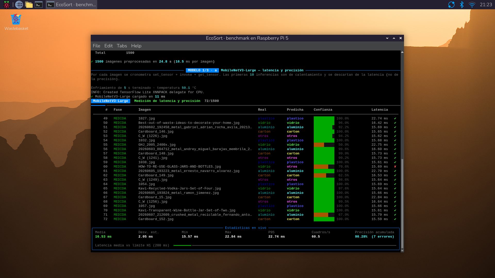

---

## 9. Cómo reproducir las pruebas

En la Raspberry Pi (carpeta `~/ecosort_benchmark/` con `benchmark_visual.py`, `modelos/` y `test_set/`):

```bash
# Requisitos (ya instalados): pip install ai-edge-litert numpy pillow psutil rich
python3 benchmark_visual.py                                       # corrida oficial (~25 min)
python3 benchmark_visual.py --num-threads 4 --duracion-estabilidad 120   # prueba con 4 hilos
python3 benchmark_visual.py --max-imagenes 200 --duracion-estabilidad 60 \
        --enfriamiento 10 --pausa-visual 0.05                     # demostración corta para video
```

Cada corrida crea `resultados_<fecha>/` con `resultados.json` y `capturas/*.svg`. En la laptop:

```bash
# Copiar los resultados de la Raspberry
scp rasp:ecosort_benchmark/resultados_<fecha>/resultados.json reports/benchmark_rpi/resultados_rpi_1hilo.json
scp -r rasp:ecosort_benchmark/resultados_<fecha>/capturas/ reports/benchmark_rpi/capturas_svg/

# Generar gráficas y convertir capturas a PNG (requiere rsvg-convert)
python tests/graficar_benchmark_rpi.py
```

Scripts:

- `tests/benchmark_visual.py`: benchmark visual de los tres modelos. Es la versión ampliada del script original, que solo probaba MobileNetV3. La copia original quedó en la Raspberry como `benchmark_visual_v1_solo_mobilenet.py.bak`.
- `tests/graficar_benchmark_rpi.py`: genera las gráficas y convierte las capturas.
- `tests/comparar_modelos_inferencia.py`: evaluación de los `.keras` en la laptop (sección 3.1).
